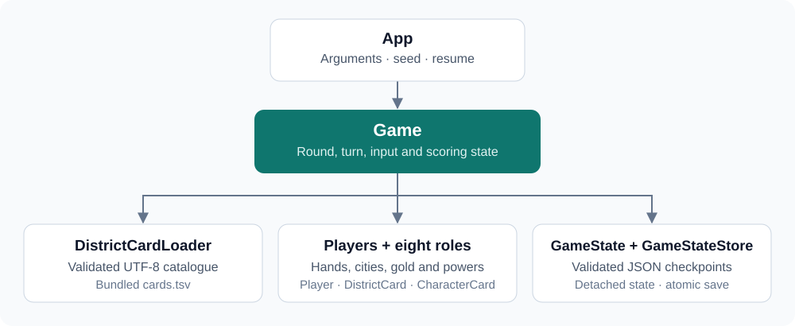

# Citadels CLI

[](https://github.com/MakenzieAhern/citadels-cli/actions/workflows/ci.yml)


**Draft a role. Build a city. Play the next round.**

A terminal strategy card game written in Java. One human player competes with automated opponents through role selection, resource collection and district building. Eight character roles create different turn powers; a validated JSON checkpoint lets you resume a session.

This is a **simplified educational implementation inspired by Citadels**. Its district catalogue includes descriptive card text, but purple district special effects are not implemented. See [rules and limits](#rules-and-limits) for the exact scope.

The project demonstrates object-oriented modelling, an iterative turn state machine, input validation, classpath resource loading, structured persistence, and automated regression testing.

## Quick start

Install **JDK 17**. The included Gradle 8.10 wrapper downloads dependencies on first use.

```bash
git clone https://github.com/MakenzieAhern/citadels-cli.git
cd citadels-cli
./gradlew --console=plain run
```

Use `gradlew.bat --console=plain run` on Windows. A terminal is sufficient; no graphical desktop, database, or external game engine is needed.

[View a recorded packaged-game session](docs/DEMO.md), including construction and save/resume.

## How a session works

1. Choose **4–7 players**: you control Player 1 and the remaining players are automated.
2. Draft a character by name or rank. The crown determines selection order; chosen opponent roles stay hidden until their turns.
3. Characters act in rank order. On your turn, take **2 gold** or **draw two district cards and keep one**. Your character power then resolves once.
4. Inspect your hand, build an affordable district, inspect other cities, or save. A normal turn allows one build; the Architect allows three. Duplicate district names are rejected.
5. Enter `end` to finish your turn. The game continues through the other players and starts a new round. The round in which a city reaches eight districts is the final round.

| Command | Purpose |
| --- | --- |
| `hand`, `gold` | Inspect your cards or balance. |
| `build <n>` | Build the numbered card from your current hand. |
| `city [player]` | Inspect a city; `citadel` and `list` are aliases. |
| `all` | Show public player summaries. |
| `info <name or n>` | Explain a character or inspect a card in your hand. |
| `action` | Explain that the role power has already resolved. |
| `save <file>`, `load <file>` | Write or restore a checkpoint at your command prompt. |
| `debug` | Toggle visibility of computer hands. |
| `end`, `t` | Finish the current turn. |
| `help` | Print commands. |
| `quit`, `exit` | Exit cleanly; accepted at every input prompt. |

Malformed commands and out-of-range choices are handled without ending the session. End-of-input exits cleanly, which also makes the application usable with scripted input.

## Eight character roles

| Rank | Role | Implemented power |
| ---: | --- | --- |
| 1 | Assassin | Choose a character whose turn will be skipped. |
| 2 | Thief | Take a living target character's gold before its turn. |
| 3 | Magician | Swap hands with another player, or replace selected cards. |
| 4 | King | Claim the crown and collect yellow-district income. |
| 5 | Bishop | Collect blue-district income and protect the city while alive. |
| 6 | Merchant | Collect green-district income plus one gold. |
| 7 | Architect | Draw two extra cards and build up to three districts. |
| 8 | Warlord | Collect red-district income and optionally destroy an eligible district. |

Computer opponents choose their roles and resolve powers without asking the human to supply their moves. Their strategy is intentionally simple: resource/hand-size heuristics, inexpensive builds and basic target selection.

## Save and resume

Create a save directory before starting the game:

```bash
mkdir -p saves
```

At your action-command prompt, after resources and the role power have resolved:

```text
save saves/My Session.json
```

Filenames retain case and may contain spaces. Resume at the same checkpoint from a new process:

```bash
java -jar build/libs/citadels-cli-1.0.0.jar --load "saves/My Session.json"
```

A checkpoint includes players, hands, cities, gold, ordered district deck, character assignments, crown, current round/turn, assassination/theft targets, and build counts. Loading does not award turn resources or role powers again. Invalid files are rejected before replacing live state; save writes use an atomic replacement in the destination directory.

The original unversioned coursework save format is not accepted because it omitted state needed for a reliable resume. Checkpoints preserve the game position, but do not persist the random generator's internal state, so future random choices may differ after restarting. The parent directory must exist, and the filesystem must support atomic replacement.

For reproducible **new** sessions, supply a seed and the same inputs:

```bash
./gradlew --console=plain run --args="--seed 42"
java -jar build/libs/citadels-cli-1.0.0.jar --help
```

## Build and verify

```bash
./gradlew clean build installDist
```

The verified local build passes **83 tests**, with **93.18% line coverage**. Failed tests fail the build. JUnit runs regression checks and JaCoCo produces coverage reports.

| Output | Location |
| --- | --- |
| Test results | `build/reports/tests/test/index.html` |
| Coverage | `build/reports/jacoco/test/html/index.html` |
| Runnable JAR | `build/libs/citadels-cli-1.0.0.jar` |
| ZIP distribution | `build/distributions/citadels-cli-1.0.0.zip` |
| Installed launcher | `build/install/citadels-cli/bin/citadels-cli` |

```bash
java -jar build/libs/citadels-cli-1.0.0.jar
```

The JAR includes the district catalogue and JSON dependency. It requires Java 17 and can run from another directory. The ZIP includes Unix and Windows launchers.

[Verification notes](docs/VERIFICATION.md) record measured results, the original baseline failure, packaged-launch checks, and test limitations. GitHub Actions builds the project on Ubuntu with Java 17 and uploads test/coverage reports.

## Architecture



The game keeps role selection and ranked turns explicit, so advancing the turn does not recursively replay earlier actions. Save loading validates a detached snapshot before replacing live state. This separates malformed-file handling from the running game.

```text
src/main/java/citadels/      Game, models, roles and persistence
src/main/resources/citadels/ District catalogue
src/test/java/citadels/      Model, gameplay, persistence and CLI tests
docs/                       Verification, demo and provenance
.github/workflows/ci.yml     Build, test and packaging checks
```

## Rules and limits

The bundled catalogue contains **79 cards across 41 district types**, with five district colours. Twenty-four district types have purple-card descriptions. Displaying those descriptions does not automatically apply their effects.

The implemented scoring is the sum of built district costs, plus 3 points for all five colours, plus 4 points for the first completed eight-district city or 2 for another completed city. Highest scores win; ties share the win.

The following limits are deliberate:

- **All purple district powers are inactive**, including special scoring, protection, discounts and duplicate-building exceptions. Purple cards still have their printed colour and construction cost.
- Resource collection and the character power happen before build commands. Powers cannot be deferred or repeated through `action`.
- A city is capped at eight districts. Seven-player drafting does not implement the optional final-player face-down-card exchange.
- Discarded/replaced/destroyed district cards return to the deck; when no cards are available for the resource action, the player receives gold instead.
- Opponents use simple heuristics, not search-based planning. There is no network multiplayer or graphical interface.

These choices make this a documented limited variant, not a complete recreation of every Citadels rule or expansion.

## Provenance

The original game code was independently developed by **Yuchen Deng**, who maintains this portfolio edition. It began as a coursework project and was re-tested and repaired for publication. [Provenance notes](docs/PROVENANCE.md) explain what was inherited, what changed, and why the repository does not assign a blanket license to the supplied game text and scaffolding.
